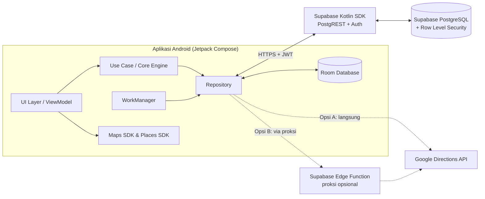
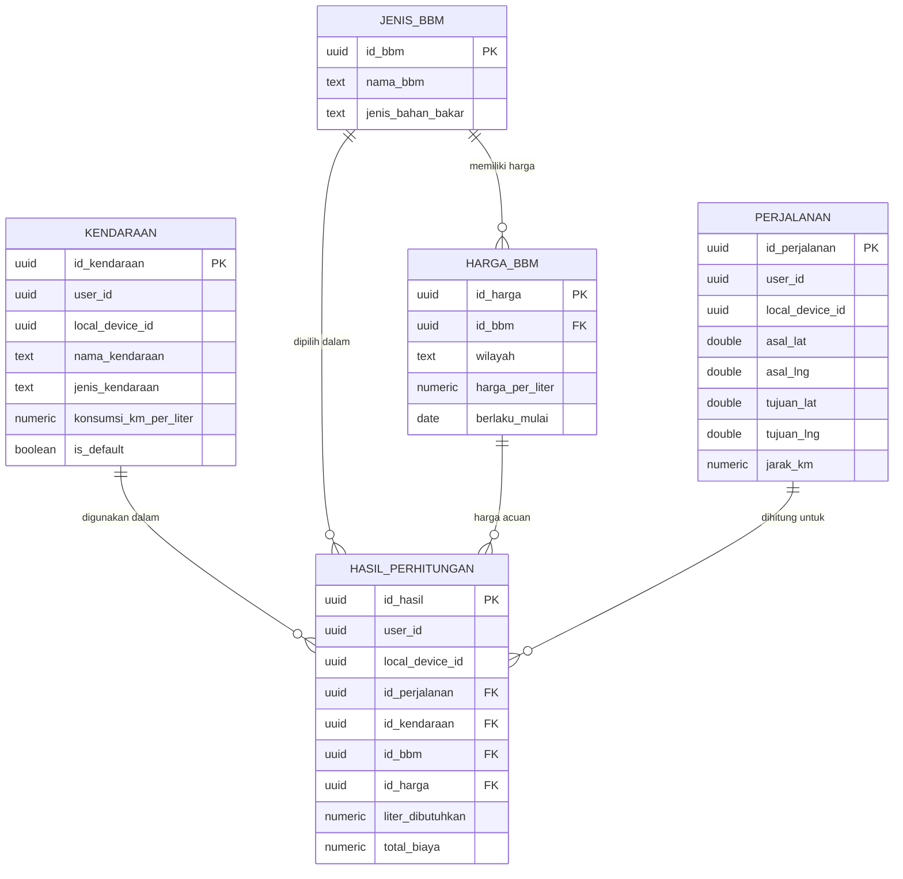
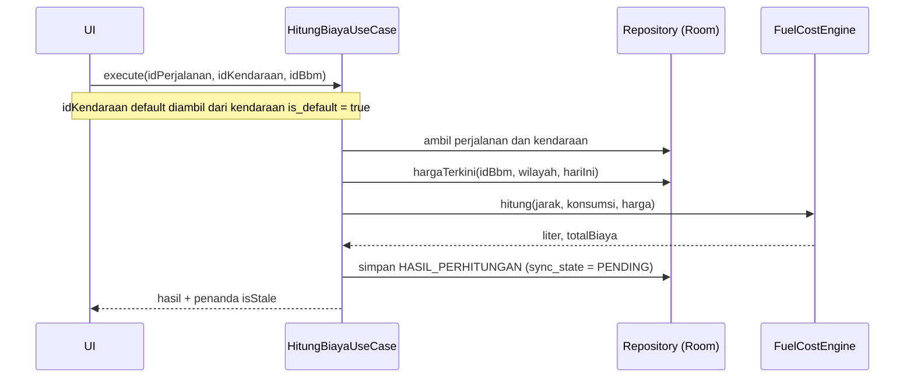
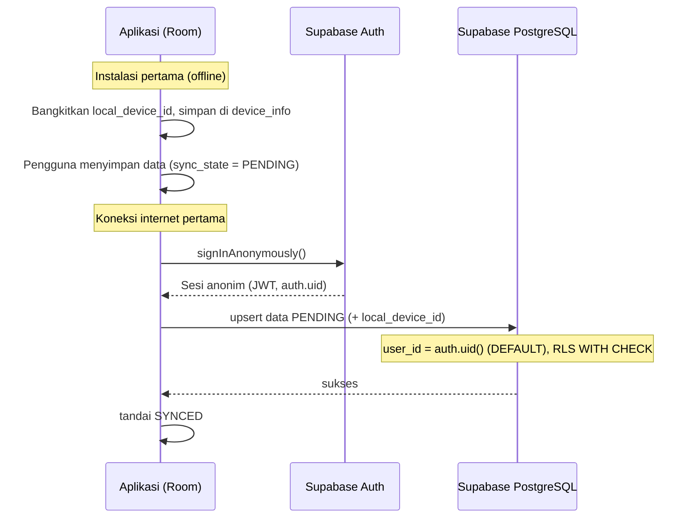
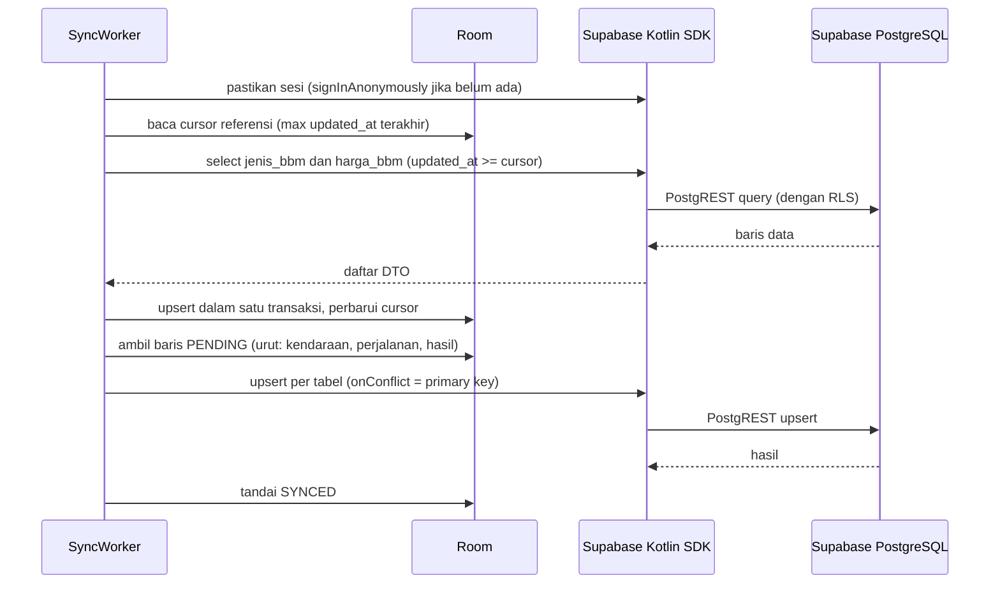
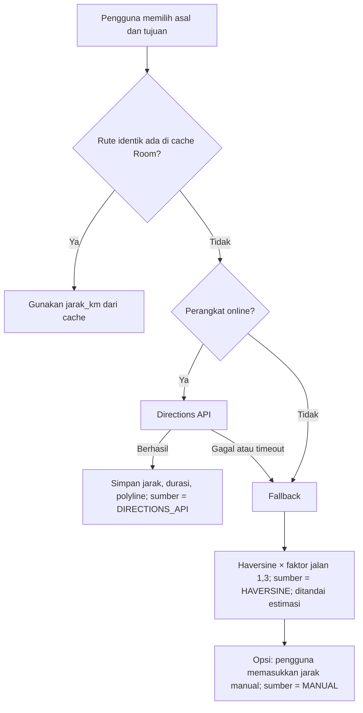

# PRD Teknikal — MyBBM

**Aplikasi Kalkulator Biaya BBM Berbasis Offline-First untuk Wilayah Kalimantan Timur**

| Atribut | Keterangan |
|---|---|
| Nama Produk | MyBBM |
| Platform | Android Native (Jetpack Compose) |
| Arsitektur | Client-to-BaaS (tanpa custom backend) |
| Cakupan Dokumen | Logika sistem (Core Engine), integrasi layanan, sinkronisasi data, dan skema database |
| Di Luar Cakupan | Perancangan UI/UX (ditangani melalui fitur Figma to Code) |
| Versi Dokumen | 2.0 |
| Status | Revisi — arsitektur Ktor Server digantikan oleh Supabase BaaS |

### Riwayat Revisi

| Versi | Perubahan |
|---|---|
| 1.0 | Draf awal (Bahasa Melayu) dengan arsitektur Ktor Server sebagai backend. |
| 2.0 | Terjemahan ke Bahasa Indonesia baku; Ktor Server dihapus; arsitektur menjadi Client-to-BaaS murni (Supabase Kotlin SDK + PostgREST + RLS); penambahan `local_device_id` dan Anonymous Auth; penambahan kolom `is_default` pada `KENDARAAN`; seluruh pertanyaan terbuka dikunci menjadi keputusan desain. |

### Daftar Isi

1. [Ringkasan Eksekutif](#1-ringkasan-eksekutif)
2. [Cakupan](#2-cakupan)
3. [Arsitektur Sistem](#3-arsitektur-sistem)
4. [Skema Database](#4-skema-database)
5. [Core Engine (Logika Perhitungan)](#5-core-engine-logika-perhitungan)
6. [Sinkronisasi Data](#6-sinkronisasi-data)
7. [Integrasi Google Maps Platform](#7-integrasi-google-maps-platform)
8. [Integrasi Supabase pada Sisi Klien](#8-integrasi-supabase-pada-sisi-klien)
9. [Kebutuhan Non-Fungsional](#9-kebutuhan-non-fungsional)
10. [Strategi Pengujian](#10-strategi-pengujian)
11. [Tahapan Implementasi](#11-tahapan-implementasi)
12. [Risiko dan Mitigasi](#12-risiko-dan-mitigasi)
13. [Keputusan Desain yang Ditetapkan](#13-keputusan-desain-yang-ditetapkan)
14. [Lampiran](#14-lampiran)

---

## 1. Ringkasan Eksekutif

MyBBM adalah aplikasi Android yang menghitung estimasi biaya bahan bakar minyak (BBM) untuk suatu perjalanan berdasarkan jarak rute, profil kendaraan, dan harga BBM terkini di Kalimantan Timur. Aplikasi harus berfungsi **sepenuhnya tanpa koneksi internet** (offline-first) dan **tanpa proses pendaftaran atau login** (zero-login). Data referensi (jenis BBM dan harga) disinkronkan dari Supabase ke Room Database saat perangkat terhubung ke internet, sedangkan data milik pengguna dicadangkan ke Supabase melalui sesi Anonymous Auth.

### 1.1 Latar Belakang Masalah

- Pengguna di Kalimantan Timur sering menempuh rute jarak jauh dengan kualitas sinyal yang tidak stabil (misalnya Samarinda–Balikpapan, Samarinda–Bontang, dan rute pedalaman).
- Harga BBM berubah dari waktu ke waktu, sementara pengguna belum memiliki rujukan yang praktis dan dapat diakses secara offline.

### 1.2 Tujuan Teknis

1. Perhitungan biaya berjalan 100% offline menggunakan data yang telah tersimpan di Room.
2. Sinkronisasi data otomatis, aman, dan idempoten saat perangkat online.
3. Hasil perhitungan deterministik dan akurat (menggunakan `BigDecimal`, bukan `Double`).
4. Keamanan akses database ditangani langsung oleh Row Level Security (RLS) Supabase tanpa server perantara.
5. Integrasi Google Maps Platform dengan strategi cache dan fallback untuk menekan biaya API dan ketergantungan jaringan.

### 1.3 Metrik Keberhasilan

| Metrik | Target |
|---|---|
| Waktu perhitungan (offline, jarak sudah diketahui) | < 100 ms |
| Tingkat keberhasilan sinkronisasi (saat online) | ≥ 99% |
| Akurasi rumus terhadap kasus uji acuan | 100% |
| *Cold start* hingga data lokal siap | < 2 detik |
| *Crash-free sessions* | ≥ 99,5% |

---

## 2. Cakupan

### 2.1 Dalam Cakupan

- Skema database Room (lokal) dan PostgreSQL Supabase (cloud) beserta kebijakan RLS.
- Core Engine perhitungan kebutuhan liter dan total biaya.
- Mekanisme sinkronisasi menggunakan Supabase Kotlin SDK (PostgREST dan Auth).
- Mekanisme Anonymous Auth dan pengikatan `local_device_id`.
- Integrasi Google Maps SDK, Directions API, dan Places API.
- Keamanan, pemantauan, dan strategi pengujian.

### 2.2 Di Luar Cakupan

- Perancangan visual dan komponen UI/UX (Figma to Code).
- Custom backend (Ktor Server atau server aplikasi lainnya).
- Pembaruan harga BBM otomatis (*scraping*), pembayaran, fitur sosial, dan pelacakan GPS *real-time*.
- Pemulihan data lintas perangkat dan login permanen (direncanakan pada pengembangan lanjutan).
- Platform iOS dan web.

---

## 3. Arsitektur Sistem

### 3.1 Gambaran Umum

Arsitektur yang digunakan adalah **Client-to-BaaS (Backend-as-a-Service) murni**. Aplikasi Android berkomunikasi langsung dengan Supabase melalui Supabase Kotlin SDK (PostgREST dan Auth). Tidak ada custom backend di antara aplikasi dan database.



Alur data utama: **Aplikasi Android (Room DB) ⟷ Supabase Kotlin SDK (PostgREST) ⟷ Supabase PostgreSQL**.

### 3.2 Prinsip Desain

1. **Offline-First / Single Source of Truth:** UI hanya membaca dari Room. Jaringan hanya berfungsi memperbarui Room dan mencadangkan data.
2. **Core Engine murni (pure Kotlin):** tidak bergantung pada Android maupun jaringan sehingga mudah diuji unit.
3. **Snapshot transaksi:** `HASIL_PERHITUNGAN` menyimpan nilai akhir (liter dan biaya) agar riwayat tidak berubah ketika harga diperbarui.
4. **Idempoten:** seluruh operasi sinkronisasi dapat diulang tanpa menghasilkan duplikasi (UUID dibangkitkan di klien).
5. **Keamanan di lapisan data:** otorisasi ditegakkan oleh RLS PostgreSQL, bukan oleh kode aplikasi.

### 3.3 Lapisan Aplikasi Android

| Lapisan | Tanggung Jawab | Teknologi |
|---|---|---|
| Presentation | State holder dan event UI | ViewModel + StateFlow |
| Domain | Core Engine dan use case | Kotlin murni |
| Data | Repository, DAO, remote data source | Room, Supabase Kotlin SDK |
| Background | Sinkronisasi berkala | WorkManager |
| Dependency Injection | Penyediaan dependensi | Hilt atau Koin |

### 3.4 Keamanan Akses Database (RLS)

Karena klien mengakses database secara langsung, keamanan data sepenuhnya bergantung pada **Row Level Security (RLS)** Supabase:

- Seluruh tabel mengaktifkan RLS.
- Aplikasi hanya menyertakan **anon (publishable) key** yang memang dirancang aman untuk berada di sisi klien selama RLS aktif. Kunci `service_role` **tidak boleh** disertakan dalam aplikasi.
- Setiap pengguna (termasuk pengguna anonim) hanya dapat membaca dan menulis baris miliknya sendiri berdasarkan `auth.uid()`.
- Tabel referensi (`JENIS_BBM` dan `HARGA_BBM`) bersifat baca-saja bagi klien; penulisan hanya dilakukan oleh pengembang melalui Supabase Studio.

Kebijakan lengkap dijabarkan pada [Bagian 4.5](#45-row-level-security-rls).

---

## 4. Skema Database

### 4.1 Entity Relationship Diagram (ERD)



### 4.2 Konvensi Umum

- **Primary key:** UUID v4. Untuk data pengguna, UUID dibangkitkan di klien agar sinkronisasi offline tidak menimbulkan bentrok.
- **Kolom audit:** `created_at`, `updated_at` (UTC; *epoch millis* di Room, `timestamptz` di PostgreSQL).
- **Soft delete:** kolom `deleted_at` (nullable) pada tabel data pengguna agar penghapusan dapat disinkronkan.
- **Mata uang:** IDR, disimpan sebagai `NUMERIC` (tanpa *floating point*).
- **Kolom `user_id`:** pada tabel data pengguna (`KENDARAAN`, `PERJALANAN`, `HASIL_PERHITUNGAN`) berisi `auth.users(id)` dengan nilai bawaan `auth.uid()`, sehingga server selalu mengisi pemilik baris dari sesi yang sedang aktif dan klien tidak dapat memalsukannya.
- **Kolom `local_device_id`:** pada tabel data pengguna di Supabase, menyimpan UUID perangkat yang dibangkitkan saat aplikasi pertama kali dipasang (lihat [Bagian 6.2](#62-identitas-perangkat-dan-anonymous-auth)).
- **Cakupan wilayah:** nilai `wilayah` dibatasi pada `'KALIMANTAN_TIMUR'` (lihat [Bagian 13](#13-keputusan-desain-yang-ditetapkan)).

### 4.3 Kamus Data

#### 4.3.1 `KENDARAAN`

| Kolom | Tipe | Kendala | Keterangan |
|---|---|---|---|
| `id_kendaraan` | UUID | PK | Pengenal kendaraan |
| `user_id` | UUID | NOT NULL, FK `auth.users`, DEFAULT `auth.uid()` | Pemilik data (sesi Anonymous Auth) |
| `local_device_id` | UUID | NOT NULL | UUID perangkat asal data |
| `nama_kendaraan` | TEXT | NOT NULL | Contoh: "Honda Beat 2021" |
| `jenis_kendaraan` | TEXT | NOT NULL, CHECK | `MOTOR`, `MOBIL`, `TRUK`, `LAINNYA` |
| `konsumsi_km_per_liter` | NUMERIC(6,2) | NOT NULL, > 0 | Rasio konsumsi bahan bakar |
| `is_default` | BOOLEAN | NOT NULL, DEFAULT false | Kendaraan utama yang dipilih otomatis pada kalkulator |
| `created_at`, `updated_at`, `deleted_at` | TIMESTAMPTZ | | Audit |

Aturan `is_default`: setiap pengguna hanya boleh memiliki **satu** kendaraan aktif dengan `is_default = true`. Kendaraan pertama yang disimpan otomatis menjadi default. Aturan ini ditegakkan di Room (transaksi DAO) dan di PostgreSQL (trigger, lihat Bagian 4.4).

#### 4.3.2 `JENIS_BBM`

| Kolom | Tipe | Kendala | Keterangan |
|---|---|---|---|
| `id_bbm` | UUID | PK | Pengenal BBM |
| `nama_bbm` | TEXT | NOT NULL, UNIQUE | Contoh: Pertalite, Pertamax, Pertamax Turbo, Dexlite, Pertamina Dex, Biosolar |
| `jenis_bahan_bakar` | TEXT | NOT NULL, CHECK | `BENSIN`, `DIESEL` |
| `is_active` | BOOLEAN | NOT NULL, DEFAULT true | Status aktif |
| `updated_at` | TIMESTAMPTZ | NOT NULL | Untuk *delta sync* |

#### 4.3.3 `HARGA_BBM`

| Kolom | Tipe | Kendala | Keterangan |
|---|---|---|---|
| `id_harga` | UUID | PK | Pengenal catatan harga |
| `id_bbm` | UUID | FK → `JENIS_BBM`, NOT NULL | BBM terkait |
| `wilayah` | TEXT | NOT NULL, DEFAULT dan CHECK `'KALIMANTAN_TIMUR'` | Kode wilayah |
| `harga_per_liter` | NUMERIC(10,2) | NOT NULL, > 0 | Harga (IDR per liter) |
| `berlaku_mulai` | DATE | NOT NULL | Tanggal mulai berlaku |
| `berlaku_hingga` | DATE | NULL | NULL berarti harga yang sedang berlaku |
| `updated_at` | TIMESTAMPTZ | NOT NULL | Untuk *delta sync* |

Kendala tambahan: `UNIQUE (id_bbm, wilayah, berlaku_mulai)`. Harga yang berlaku adalah catatan dengan `berlaku_mulai` terbaru yang tidak melebihi tanggal perhitungan.

#### 4.3.4 `PERJALANAN`

| Kolom | Tipe | Kendala | Keterangan |
|---|---|---|---|
| `id_perjalanan` | UUID | PK | Pengenal perjalanan |
| `user_id` | UUID | NOT NULL, FK `auth.users`, DEFAULT `auth.uid()` | Pemilik data |
| `local_device_id` | UUID | NOT NULL | UUID perangkat asal data |
| `label` | TEXT | NULL | Nama perjalanan |
| `asal_nama`, `tujuan_nama` | TEXT | NULL | Nama tempat (Places API) |
| `asal_place_id`, `tujuan_place_id` | TEXT | NULL | Google Place ID |
| `asal_lat`, `asal_lng` | DOUBLE PRECISION | NOT NULL | Koordinat asal |
| `tujuan_lat`, `tujuan_lng` | DOUBLE PRECISION | NOT NULL | Koordinat tujuan |
| `jarak_km` | NUMERIC(8,2) | NOT NULL, ≥ 0 | Jarak rute |
| `durasi_menit` | INTEGER | NULL | Estimasi waktu tempuh |
| `encoded_polyline` | TEXT | NULL | Rute untuk ditampilkan di peta saat offline |
| `sumber_jarak` | TEXT | NOT NULL | `DIRECTIONS_API`, `HAVERSINE`, `MANUAL` |
| `created_at`, `updated_at`, `deleted_at` | TIMESTAMPTZ | | Audit |

#### 4.3.5 `HASIL_PERHITUNGAN`

| Kolom | Tipe | Kendala | Keterangan |
|---|---|---|---|
| `id_hasil` | UUID | PK | Pengenal hasil |
| `user_id` | UUID | NOT NULL, FK `auth.users`, DEFAULT `auth.uid()` | Pemilik data |
| `local_device_id` | UUID | NOT NULL | UUID perangkat asal data |
| `id_perjalanan` | UUID | FK → `PERJALANAN`, NOT NULL | Perjalanan |
| `id_kendaraan` | UUID | FK → `KENDARAAN`, NOT NULL | Kendaraan |
| `id_bbm` | UUID | FK → `JENIS_BBM`, NOT NULL | BBM yang dipilih |
| `id_harga` | UUID | FK → `HARGA_BBM`, NOT NULL | Catatan harga yang digunakan |
| `liter_dibutuhkan` | NUMERIC(8,3) | NOT NULL, ≥ 0 | Hasil perhitungan liter |
| `total_biaya` | NUMERIC(14,2) | NOT NULL, ≥ 0 | Total biaya (IDR) |
| `created_at`, `updated_at`, `deleted_at` | TIMESTAMPTZ | | Audit |

### 4.4 DDL PostgreSQL (Supabase)

```sql
-- Ekstensi
create extension if not exists "pgcrypto";

-- 1. JENIS_BBM
create table public.jenis_bbm (
  id_bbm            uuid primary key default gen_random_uuid(),
  nama_bbm          text not null unique,
  jenis_bahan_bakar text not null check (jenis_bahan_bakar in ('BENSIN','DIESEL')),
  is_active         boolean not null default true,
  updated_at        timestamptz not null default now()
);

-- 2. HARGA_BBM
create table public.harga_bbm (
  id_harga        uuid primary key default gen_random_uuid(),
  id_bbm          uuid not null references public.jenis_bbm(id_bbm),
  wilayah         text not null default 'KALIMANTAN_TIMUR'
                    check (wilayah = 'KALIMANTAN_TIMUR'),
  harga_per_liter numeric(10,2) not null check (harga_per_liter > 0),
  berlaku_mulai   date not null,
  berlaku_hingga  date,
  updated_at      timestamptz not null default now(),
  unique (id_bbm, wilayah, berlaku_mulai)
);
create index idx_harga_lookup on public.harga_bbm (id_bbm, wilayah, berlaku_mulai desc);
create index idx_harga_updated on public.harga_bbm (updated_at);
create index idx_jenis_bbm_updated on public.jenis_bbm (updated_at);

-- 3. KENDARAAN
create table public.kendaraan (
  id_kendaraan          uuid primary key,
  user_id               uuid not null default auth.uid()
                          references auth.users(id) on delete cascade,
  local_device_id       uuid not null,
  nama_kendaraan        text not null,
  jenis_kendaraan       text not null check (jenis_kendaraan in ('MOTOR','MOBIL','TRUK','LAINNYA')),
  konsumsi_km_per_liter numeric(6,2) not null check (konsumsi_km_per_liter > 0),
  is_default            boolean not null default false,
  created_at            timestamptz not null default now(),
  updated_at            timestamptz not null default now(),
  deleted_at            timestamptz
);
create index idx_kendaraan_user on public.kendaraan (user_id, updated_at);

-- 4. PERJALANAN
create table public.perjalanan (
  id_perjalanan    uuid primary key,
  user_id          uuid not null default auth.uid()
                     references auth.users(id) on delete cascade,
  local_device_id  uuid not null,
  label            text,
  asal_nama        text,
  tujuan_nama      text,
  asal_place_id    text,
  tujuan_place_id  text,
  asal_lat         double precision not null check (asal_lat between -90 and 90),
  asal_lng         double precision not null check (asal_lng between -180 and 180),
  tujuan_lat       double precision not null check (tujuan_lat between -90 and 90),
  tujuan_lng       double precision not null check (tujuan_lng between -180 and 180),
  jarak_km         numeric(8,2) not null check (jarak_km >= 0),
  durasi_menit     integer,
  encoded_polyline text,
  sumber_jarak     text not null check (sumber_jarak in ('DIRECTIONS_API','HAVERSINE','MANUAL')),
  created_at       timestamptz not null default now(),
  updated_at       timestamptz not null default now(),
  deleted_at       timestamptz
);
create index idx_perjalanan_user on public.perjalanan (user_id, updated_at);

-- 5. HASIL_PERHITUNGAN
create table public.hasil_perhitungan (
  id_hasil         uuid primary key,
  user_id          uuid not null default auth.uid()
                     references auth.users(id) on delete cascade,
  local_device_id  uuid not null,
  id_perjalanan    uuid not null references public.perjalanan(id_perjalanan),
  id_kendaraan     uuid not null references public.kendaraan(id_kendaraan),
  id_bbm           uuid not null references public.jenis_bbm(id_bbm),
  id_harga         uuid not null references public.harga_bbm(id_harga),
  liter_dibutuhkan numeric(8,3)  not null check (liter_dibutuhkan >= 0),
  total_biaya      numeric(14,2) not null check (total_biaya >= 0),
  created_at       timestamptz not null default now(),
  updated_at       timestamptz not null default now(),
  deleted_at       timestamptz
);
create index idx_hasil_user on public.hasil_perhitungan (user_id, updated_at);

-- ============ TRIGGER ============

-- (a) Tabel referensi: updated_at diisi otomatis oleh server
create or replace function public.set_updated_at() returns trigger as $$
begin new.updated_at = now(); return new; end; $$ language plpgsql;

create trigger trg_jenis_bbm_upd before update on public.jenis_bbm
  for each row execute function public.set_updated_at();
create trigger trg_harga_bbm_upd before update on public.harga_bbm
  for each row execute function public.set_updated_at();

-- (b) Tabel data pengguna: tolak pembaruan yang lebih lama dari data di server
--     (Last-Write-Wins berdasarkan updated_at yang dikirim klien)
create or replace function public.reject_stale_update() returns trigger as $$
begin
  if new.updated_at < old.updated_at then
    return null;  -- abaikan pembaruan usang
  end if;
  return new;
end; $$ language plpgsql;

create trigger trg_kendaraan_stale before update on public.kendaraan
  for each row execute function public.reject_stale_update();
create trigger trg_perjalanan_stale before update on public.perjalanan
  for each row execute function public.reject_stale_update();
create trigger trg_hasil_stale before update on public.hasil_perhitungan
  for each row execute function public.reject_stale_update();

-- (c) Hanya satu kendaraan default aktif per pengguna
create or replace function public.enforce_single_default_kendaraan() returns trigger as $$
begin
  if new.is_default and new.deleted_at is null then
    update public.kendaraan
       set is_default = false, updated_at = now()
     where user_id = new.user_id
       and id_kendaraan <> new.id_kendaraan
       and is_default = true;
  end if;
  return new;
end; $$ language plpgsql;

create trigger trg_kendaraan_default after insert or update of is_default on public.kendaraan
  for each row when (new.is_default) execute function public.enforce_single_default_kendaraan();

-- (d) Penutupan otomatis harga lama saat harga baru ditambahkan via Supabase Studio
create or replace function public.close_previous_harga() returns trigger as $$
begin
  update public.harga_bbm
     set berlaku_hingga = new.berlaku_mulai - 1
   where id_bbm = new.id_bbm
     and wilayah = new.wilayah
     and id_harga <> new.id_harga
     and berlaku_hingga is null
     and berlaku_mulai < new.berlaku_mulai;
  return new;
end; $$ language plpgsql;

create trigger trg_harga_close_prev after insert on public.harga_bbm
  for each row execute function public.close_previous_harga();
```

### 4.5 Row Level Security (RLS)

```sql
alter table public.jenis_bbm         enable row level security;
alter table public.harga_bbm         enable row level security;
alter table public.kendaraan         enable row level security;
alter table public.perjalanan        enable row level security;
alter table public.hasil_perhitungan enable row level security;

-- Data referensi: dapat dibaca klien (anon maupun authenticated), tidak dapat ditulis klien
create policy "baca_jenis_bbm" on public.jenis_bbm
  for select to anon, authenticated using (true);
create policy "baca_harga_bbm" on public.harga_bbm
  for select to anon, authenticated using (true);
-- Tidak ada policy INSERT/UPDATE/DELETE → seluruh penulisan dari klien ditolak.
-- Pengembang menulis data melalui Supabase Studio (role postgres melewati RLS).

-- Data pengguna: hanya pemilik (sesi Anonymous Auth termasuk role 'authenticated')
create policy "milik_sendiri_kendaraan" on public.kendaraan
  for all to authenticated
  using (user_id = auth.uid()) with check (user_id = auth.uid());

create policy "milik_sendiri_perjalanan" on public.perjalanan
  for all to authenticated
  using (user_id = auth.uid()) with check (user_id = auth.uid());

create policy "milik_sendiri_hasil" on public.hasil_perhitungan
  for all to authenticated
  using (user_id = auth.uid()) with check (user_id = auth.uid());
```

Catatan konfigurasi: fitur **Anonymous Sign-Ins** harus diaktifkan pada Supabase Dashboard (Authentication → Sign In / Providers). Pengguna anonim menggunakan role `authenticated` dengan klaim JWT `is_anonymous = true`.

### 4.6 Entitas Room (Lokal)

```kotlin
/** Menyimpan metadata perangkat; hanya satu baris (key-value). */
@Entity(tableName = "device_info")
data class DeviceInfoEntity(
    @PrimaryKey val key: String,        // contoh: "local_device_id"
    val value: String
)

@Entity(tableName = "jenis_bbm")
data class JenisBbmEntity(
    @PrimaryKey @ColumnInfo(name = "id_bbm") val idBbm: String,
    @ColumnInfo(name = "nama_bbm") val namaBbm: String,
    @ColumnInfo(name = "jenis_bahan_bakar") val jenisBahanBakar: String,
    @ColumnInfo(name = "is_active") val isActive: Boolean = true,
    @ColumnInfo(name = "updated_at") val updatedAt: Long
)

@Entity(
    tableName = "harga_bbm",
    foreignKeys = [ForeignKey(JenisBbmEntity::class, ["id_bbm"], ["id_bbm"])],
    indices = [Index(value = ["id_bbm", "wilayah", "berlaku_mulai"], unique = true)]
)
data class HargaBbmEntity(
    @PrimaryKey @ColumnInfo(name = "id_harga") val idHarga: String,
    @ColumnInfo(name = "id_bbm") val idBbm: String,
    val wilayah: String,
    @ColumnInfo(name = "harga_per_liter") val hargaPerLiter: String, // BigDecimal sebagai String
    @ColumnInfo(name = "berlaku_mulai") val berlakuMulai: Long,
    @ColumnInfo(name = "berlaku_hingga") val berlakuHingga: Long?,
    @ColumnInfo(name = "updated_at") val updatedAt: Long
)

@Entity(tableName = "kendaraan")
data class KendaraanEntity(
    @PrimaryKey @ColumnInfo(name = "id_kendaraan") val idKendaraan: String,
    @ColumnInfo(name = "nama_kendaraan") val namaKendaraan: String,
    @ColumnInfo(name = "jenis_kendaraan") val jenisKendaraan: String,
    @ColumnInfo(name = "konsumsi_km_per_liter") val konsumsiKmPerLiter: String,
    @ColumnInfo(name = "is_default") val isDefault: Boolean = false,
    @ColumnInfo(name = "created_at") val createdAt: Long,
    @ColumnInfo(name = "updated_at") val updatedAt: Long,
    @ColumnInfo(name = "deleted_at") val deletedAt: Long? = null,
    @ColumnInfo(name = "sync_state") val syncState: Int = SyncState.PENDING
)

@Entity(tableName = "perjalanan")
data class PerjalananEntity(
    @PrimaryKey @ColumnInfo(name = "id_perjalanan") val idPerjalanan: String,
    val label: String?,
    @ColumnInfo(name = "asal_nama") val asalNama: String?,
    @ColumnInfo(name = "tujuan_nama") val tujuanNama: String?,
    @ColumnInfo(name = "asal_place_id") val asalPlaceId: String?,
    @ColumnInfo(name = "tujuan_place_id") val tujuanPlaceId: String?,
    @ColumnInfo(name = "asal_lat") val asalLat: Double,
    @ColumnInfo(name = "asal_lng") val asalLng: Double,
    @ColumnInfo(name = "tujuan_lat") val tujuanLat: Double,
    @ColumnInfo(name = "tujuan_lng") val tujuanLng: Double,
    @ColumnInfo(name = "jarak_km") val jarakKm: String,
    @ColumnInfo(name = "durasi_menit") val durasiMenit: Int?,
    @ColumnInfo(name = "encoded_polyline") val encodedPolyline: String?,
    @ColumnInfo(name = "sumber_jarak") val sumberJarak: String,
    @ColumnInfo(name = "created_at") val createdAt: Long,
    @ColumnInfo(name = "updated_at") val updatedAt: Long,
    @ColumnInfo(name = "deleted_at") val deletedAt: Long? = null,
    @ColumnInfo(name = "sync_state") val syncState: Int = SyncState.PENDING
)

@Entity(
    tableName = "hasil_perhitungan",
    foreignKeys = [
        ForeignKey(PerjalananEntity::class, ["id_perjalanan"], ["id_perjalanan"]),
        ForeignKey(KendaraanEntity::class, ["id_kendaraan"], ["id_kendaraan"]),
        ForeignKey(JenisBbmEntity::class, ["id_bbm"], ["id_bbm"]),
        ForeignKey(HargaBbmEntity::class, ["id_harga"], ["id_harga"])
    ],
    indices = [Index("id_perjalanan"), Index("id_kendaraan"), Index("id_bbm"), Index("id_harga")]
)
data class HasilPerhitunganEntity(
    @PrimaryKey @ColumnInfo(name = "id_hasil") val idHasil: String,
    @ColumnInfo(name = "id_perjalanan") val idPerjalanan: String,
    @ColumnInfo(name = "id_kendaraan") val idKendaraan: String,
    @ColumnInfo(name = "id_bbm") val idBbm: String,
    @ColumnInfo(name = "id_harga") val idHarga: String,
    @ColumnInfo(name = "liter_dibutuhkan") val literDibutuhkan: String,
    @ColumnInfo(name = "total_biaya") val totalBiaya: String,
    @ColumnInfo(name = "created_at") val createdAt: Long,
    @ColumnInfo(name = "updated_at") val updatedAt: Long,
    @ColumnInfo(name = "deleted_at") val deletedAt: Long? = null,
    @ColumnInfo(name = "sync_state") val syncState: Int = SyncState.PENDING
)

object SyncState { const val SYNCED = 0; const val PENDING = 1 }
```

**Catatan implementasi:**

- Nilai desimal disimpan sebagai `String` di Room dan dikonversi menjadi `BigDecimal` melalui `TypeConverter` untuk menghindari galat presisi `Double`.
- Kolom `sync_state` hanya ada di Room (tidak dikirim ke cloud).
- Kolom `user_id` **tidak** disimpan di Room. Nilai tersebut diisi dari sesi Supabase saat *push*, dan di sisi server juga dijamin oleh `DEFAULT auth.uid()` serta kebijakan RLS.
- Kolom `local_device_id` tidak diduplikasi pada setiap baris Room; nilainya dibaca dari tabel `device_info` dan ditambahkan oleh *mapper* DTO saat *push*.

**Pengaturan kendaraan default pada DAO:**

```kotlin
@Dao
interface KendaraanDao {
    @Query("UPDATE kendaraan SET is_default = 0, sync_state = 1, updated_at = :now WHERE is_default = 1 AND deleted_at IS NULL")
    suspend fun clearDefault(now: Long)

    @Query("UPDATE kendaraan SET is_default = 1, sync_state = 1, updated_at = :now WHERE id_kendaraan = :id")
    suspend fun markDefault(id: String, now: Long)

    @Transaction
    suspend fun setDefault(id: String, now: Long) {
        clearDefault(now)
        markDefault(id, now)
    }

    @Query("SELECT * FROM kendaraan WHERE is_default = 1 AND deleted_at IS NULL LIMIT 1")
    fun observeDefault(): Flow<KendaraanEntity?>
}
```

Jika kendaraan default dihapus (*soft delete*), aplikasi menetapkan kendaraan aktif yang paling baru dibuat sebagai default baru; jika tidak ada kendaraan tersisa, tidak ada default.

---

## 5. Core Engine (Logika Perhitungan)

### 5.1 Rumus

```
Kebutuhan Liter = Jarak (km) / Konsumsi Kendaraan (km/L)
Total Biaya     = Kebutuhan Liter × Harga BBM (per liter)
```

### 5.2 Spesifikasi Presisi

| Nilai | Tipe | Skala | Mode Pembulatan |
|---|---|---|---|
| Jarak (km) | `BigDecimal` | 2 | `HALF_UP` |
| Konsumsi (km/L) | `BigDecimal` | 2 | `HALF_UP` |
| Liter | `BigDecimal` | 3 (pembagian memakai `MathContext` 12 digit sebelum dibulatkan) | `HALF_UP` |
| Harga per liter | `BigDecimal` | 2 | `HALF_UP` |
| Total biaya | `BigDecimal` | 2 pada penyimpanan; 0 (rupiah penuh) pada tampilan | `HALF_UP` |

Biaya dihitung menggunakan **liter yang belum dibulatkan** untuk mencegah akumulasi galat, kemudian dibulatkan satu kali pada akhir proses. Nilai liter yang disimpan dan ditampilkan dibulatkan hingga 3 angka desimal.

### 5.3 Implementasi Acuan

```kotlin
object FuelCostEngine {

    private val DIV_CONTEXT = MathContext(12, RoundingMode.HALF_UP)
    private val MAX_JARAK_KM = BigDecimal("5000")

    data class Input(
        val jarakKm: BigDecimal,
        val konsumsiKmPerLiter: BigDecimal,
        val hargaPerLiter: BigDecimal
    )

    data class Output(
        val literDibutuhkan: BigDecimal, // skala 3
        val totalBiaya: BigDecimal       // skala 2
    )

    enum class CalcError {
        JARAK_NEGATIF, JARAK_TERLALU_BESAR, KONSUMSI_TIDAK_VALID, HARGA_TIDAK_VALID
    }

    sealed interface Result {
        data class Success(val output: Output) : Result
        data class Failure(val error: CalcError) : Result
    }

    fun hitung(input: Input): Result {
        if (input.jarakKm < BigDecimal.ZERO) return Result.Failure(CalcError.JARAK_NEGATIF)
        if (input.jarakKm > MAX_JARAK_KM) return Result.Failure(CalcError.JARAK_TERLALU_BESAR)
        if (input.konsumsiKmPerLiter <= BigDecimal.ZERO) return Result.Failure(CalcError.KONSUMSI_TIDAK_VALID)
        if (input.hargaPerLiter <= BigDecimal.ZERO) return Result.Failure(CalcError.HARGA_TIDAK_VALID)

        val literPenuh = input.jarakKm.divide(input.konsumsiKmPerLiter, DIV_CONTEXT)
        val totalPenuh = literPenuh.multiply(input.hargaPerLiter)

        return Result.Success(
            Output(
                literDibutuhkan = literPenuh.setScale(3, RoundingMode.HALF_UP),
                totalBiaya = totalPenuh.setScale(2, RoundingMode.HALF_UP)
            )
        )
    }
}
```

### 5.4 Contoh Kasus Uji Acuan

| No. | Jarak (km) | Konsumsi (km/L) | Harga (Rp/L) | Liter | Total (Rp) |
|---|---|---|---|---|---|
| 1 | 120,00 | 40,00 | 10.000,00 | 3,000 | 30.000,00 |
| 2 | 125,50 | 12,00 | 12.500,00 | 10,458 | 130.729,17 |
| 3 | 0,00 | 15,00 | 10.000,00 | 0,000 | 0,00 |
| 4 | 1,00 | 3,00 | 10.000,00 | 0,333 | 3.333,33 |

> Nilai harga pada tabel hanyalah contoh pengujian, bukan harga resmi. Harga sebenarnya selalu berasal dari tabel `HARGA_BBM`.

### 5.5 Pemilihan Harga (*Price Resolver*)

1. Filter: `id_bbm = :idBbm AND wilayah = 'KALIMANTAN_TIMUR' AND berlaku_mulai <= :tanggalPerhitungan`.
2. Urutkan `berlaku_mulai DESC`, ambil catatan pertama.
3. Jika tidak ada catatan, kembalikan `Failure(HARGA_TIDAK_TERSEDIA)`; UI mengarahkan pengguna untuk melakukan sinkronisasi atau memasukkan harga secara manual.

```kotlin
@Query("""
    SELECT * FROM harga_bbm
    WHERE id_bbm = :idBbm AND wilayah = :wilayah AND berlaku_mulai <= :tanggal
    ORDER BY berlaku_mulai DESC LIMIT 1
""")
suspend fun hargaTerkini(idBbm: String, wilayah: String, tanggal: Long): HargaBbmEntity?
```

Jika harga terbaru berusia lebih dari **30 hari** (ambang dapat dikonfigurasi), hasil diberi penanda `isStale = true` agar UI dapat menampilkan peringatan. Perhitungan tetap diperbolehkan.

### 5.6 Alur Use Case "Hitung dan Simpan"



Seluruh penyimpanan dilakukan dalam satu transaksi Room (`@Transaction`). Pada layar kalkulator, kendaraan dengan `is_default = true` dipilih otomatis sehingga pengguna tidak perlu memilih kendaraan setiap kali membuka aplikasi.

### 5.7 Aturan Validasi Input

| Kolom | Aturan |
|---|---|
| `konsumsi_km_per_liter` | > 0 dan ≤ 100 |
| `jarak_km` | ≥ 0 dan ≤ 5000 |
| Koordinat | Lat −90 s.d. 90; Lng −180 s.d. 180 |
| `nama_kendaraan` | 1–60 karakter |

---

## 6. Sinkronisasi Data

### 6.1 Strategi

| Arah | Data | Metode |
|---|---|---|
| **Pull** (Supabase → Room) | `JENIS_BBM`, `HARGA_BBM` | *Delta sync* berdasarkan `updated_at` melalui filter PostgREST |
| **Push** (Room → Supabase) | `KENDARAAN`, `PERJALANAN`, `HASIL_PERHITUNGAN` berstatus `PENDING` | *Batch upsert* idempoten |
| Pull data pengguna | Data pengguna dari cloud ke Room | Tidak digunakan pada v1; skema telah disiapkan untuk pengembangan lanjutan (login permanen) |

Pada v1, sinkronisasi data pengguna berfungsi sebagai **pencadangan** ke cloud. Karena setiap akun anonim terikat pada satu instalasi aplikasi, pemulihan data lintas perangkat berada di luar cakupan v1.

### 6.2 Identitas Perangkat dan Anonymous Auth

Aplikasi bersifat **offline-first** dan **zero-login**, sehingga identitas pengguna dibangun secara bertahap:

**Tahap 1 — Instalasi pertama (offline).**
Saat aplikasi pertama kali dijalankan, aplikasi membangkitkan `local_device_id` (UUID v4) dan menyimpannya pada tabel `device_info` di Room. Nilai ini tidak berubah selama aplikasi terpasang. Seluruh data yang dibuat pengguna disimpan di Room dengan `sync_state = PENDING`; aplikasi sepenuhnya dapat digunakan tanpa sesi cloud.

**Tahap 2 — Koneksi internet pertama.**
Ketika perangkat pertama kali terhubung ke internet dan belum memiliki sesi, `SyncWorker` secara otomatis memanggil **Supabase Auth Anonymous Sign-In** di latar belakang (tanpa interaksi pengguna). Sesi (JWT dan *refresh token*) disimpan secara aman oleh SDK pada penyimpanan terenkripsi.

**Tahap 3 — Pengikatan saat *push*.**
Pada saat *push*, aplikasi memetakan setiap baris Room menjadi DTO yang memuat `local_device_id` dari `device_info`. Kolom `user_id` terisi dengan `auth.users(id)` milik sesi anonim saat itu (melalui `DEFAULT auth.uid()` dan diverifikasi oleh RLS `WITH CHECK`). Dengan cara ini, `local_device_id` terikat pada `auth.users(id)` pada setiap baris data yang disinkronkan.



Batasan v1: apabila data aplikasi dihapus atau aplikasi dipasang ulang, sesi anonim ikut hilang sehingga data cloud lama tidak dapat diakses kembali oleh instalasi baru. Peningkatan ke akun permanen (*identity linking*) menjadi rencana pengembangan lanjutan.

### 6.3 Pemicu Sinkronisasi

1. Aplikasi dibuka dan jaringan tersedia.
2. `WorkManager` berkala (setiap 6 jam, *constraint* `NetworkType.CONNECTED`).
3. Setelah pengguna menyimpan data baru (*one-time work* dengan *constraint* jaringan).
4. *Pull-to-refresh* manual.

### 6.4 Urutan Sinkronisasi



Penjelasan:

- **Kursor pull:** karena tidak ada server aplikasi yang mengembalikan waktu server, kursor diambil dari **nilai `updated_at` terbesar** pada data yang berhasil ditarik (bukan dari jam perangkat) untuk menghindari *clock skew*. Filter memakai `>=` dan data di-*upsert* secara idempoten sehingga baris dengan stempel waktu sama tidak terlewat.
- **Paginasi:** setiap *pull* dibatasi 1.000 baris per permintaan dan diulang hingga habis.
- **Urutan push:** `KENDARAAN` → `PERJALANAN` → `HASIL_PERHITUNGAN` untuk memenuhi *foreign key*.

### 6.5 Penyelesaian Konflik

- **Data referensi:** server selalu menang (klien hanya membaca).
- **Data pengguna:** *Last-Write-Wins* berdasarkan `updated_at`; trigger `reject_stale_update` pada PostgreSQL mengabaikan pembaruan yang lebih lama daripada data di server. Pada v1 konflik praktis tidak terjadi karena satu akun anonim hanya digunakan oleh satu instalasi.
- **Penghapusan:** menggunakan *soft delete* (`deleted_at`); pembersihan fisik dilakukan setelah 90 hari.
- **Kendaraan default:** trigger `enforce_single_default_kendaraan` menjamin hanya satu kendaraan default aktif per pengguna di server.

### 6.6 Metadata Sinkronisasi (Room)

```kotlin
@Entity(tableName = "sync_meta")
data class SyncMetaEntity(
    @PrimaryKey val key: String,   // contoh: "reference_cursor"
    val value: Long
)
```

### 6.7 Kebijakan *Retry*

- *Exponential backoff* melalui WorkManager (30 detik hingga maksimum 1 jam).
- Percobaan ulang hanya untuk galat jaringan dan respons 5xx; respons 4xx dicatat sebagai gagal, kecuali 401 (sesi dimuat ulang atau Anonymous Sign-In diulang) dan 429.
- Galat pelanggaran RLS (403) dicatat sebagai galat konfigurasi dan tidak diulang.

### 6.8 Data *Seed* (Instalasi Pertama)

Berkas aset `seed_reference.json` di dalam APK memuat `JENIS_BBM` dan *snapshot* `HARGA_BBM` Kalimantan Timur terbaru saat rilis. Data ini dimuat melalui `RoomDatabase.Callback.onCreate` sehingga aplikasi dapat digunakan sepenuhnya walaupun pengguna tidak pernah online setelah instalasi.

---

## 7. Integrasi Google Maps Platform

### 7.1 Ringkasan Penggunaan

| Layanan | Kegunaan | Mode Online | Mode Offline |
|---|---|---|---|
| Maps SDK for Android | Tampilan peta dan rute | Tile online | Hanya tile yang tersimpan di cache; polyline dari `encoded_polyline` |
| Places API | Autocomplete asal/tujuan dan koordinat | Penuh | Memilih dari tempat tersimpan atau memasukkan koordinat manual |
| Directions API | Jarak (km), durasi, polyline | Penuh | *Fallback* Haversine × faktor, atau input jarak manual |

### 7.2 Alur Memperoleh Jarak



### 7.3 Pengamanan API Key (Tanpa Backend Kustom)

Karena tidak ada server perantara, pengamanan kunci dilakukan melalui pembatasan langsung di **Google Cloud Console**:

| Layanan | Mekanisme Pengamanan |
|---|---|
| Maps SDK for Android dan Places API | **API Key Restriction**: *Application restriction* tipe Android apps (**Package Name + SHA-1 certificate fingerprint**) dan *API restriction* yang hanya mengizinkan Maps SDK for Android dan Places API. |
| Directions API | Lihat Bagian 7.4. |

Praktik tambahan:

- Daftarkan SHA-1 untuk *debug*, *release*, dan (jika memakai Play App Signing) sertifikat penandatanganan dari Google Play.
- Kunci disimpan pada `local.properties` atau Secrets Gradle Plugin dan tidak dimasukkan ke *version control*.
- Tetapkan kuota harian dan peringatan tagihan (*budget alert*) pada Google Cloud Console.

### 7.4 Directions API: Dua Opsi Pengamanan

Directions API merupakan layanan web, sehingga mekanisme pembatasan kunci perlu diperlakukan secara terpisah dari Maps SDK.

**Opsi A — Panggilan langsung dari aplikasi (default v1).**
Aplikasi memanggil Directions API menggunakan kunci terpisah yang dibatasi hanya untuk Directions API dan dibatasi pada aplikasi Android (Package Name + SHA-1; permintaan menyertakan *header* `X-Android-Package` dan `X-Android-Cert`). Opsi ini paling sederhana dan cukup untuk skala penggunaan awal.

**Opsi B — Proksi ringan dengan Supabase Edge Functions (jika diperlukan).**
Apabila risiko penyalahgunaan kunci atau biaya API meningkat, panggilan Directions dialihkan melalui Supabase Edge Function. Kunci Google disimpan sebagai *secret* di Supabase (tidak ada di APK), fungsi memverifikasi JWT pengguna (termasuk sesi anonim), dan dapat menambahkan validasi input serta pembatasan laju. Fungsi ini bersifat *stateless* dan ringan; bukan merupakan custom backend aplikasi.

```ts
// supabase/functions/directions-proxy/index.ts
// verify_jwt aktif (default): hanya sesi Supabase yang sah yang dapat memanggil
Deno.serve(async (req) => {
  const { origin, destination } = await req.json();

  const valid = (p: any) =>
    typeof p?.lat === "number" && typeof p?.lng === "number" &&
    Math.abs(p.lat) <= 90 && Math.abs(p.lng) <= 180;
  if (!valid(origin) || !valid(destination)) {
    return new Response(JSON.stringify({ error: "INPUT_TIDAK_VALID" }), { status: 400 });
  }

  const url = new URL("https://maps.googleapis.com/maps/api/directions/json");
  url.searchParams.set("origin", `${origin.lat},${origin.lng}`);
  url.searchParams.set("destination", `${destination.lat},${destination.lng}`);
  url.searchParams.set("mode", "driving");
  url.searchParams.set("region", "id");
  url.searchParams.set("language", "id");
  url.searchParams.set("key", Deno.env.get("GOOGLE_DIRECTIONS_API_KEY")!);

  const res = await fetch(url);
  return new Response(await res.text(), {
    status: res.status,
    headers: { "Content-Type": "application/json" },
  });
});
```

Pemanggilan dari aplikasi menggunakan modul `functions-kt` pada Supabase Kotlin SDK (`supabase.functions.invoke("directions-proxy", body)`). Sumber data rute tetap diabstraksikan pada `RouteRemoteDataSource` sehingga perpindahan dari Opsi A ke Opsi B tidak memengaruhi Core Engine.

> Catatan: Google memosisikan Routes API sebagai penerus Directions API (*Legacy*). Evaluasi migrasi dapat dilakukan pada pengembangan lanjutan tanpa mengubah kontrak `RouteRemoteDataSource`.

### 7.5 Spesifikasi Directions API

- Parameter: `origin`, `destination` (lat,lng atau `place_id:`), `mode=driving`, `alternatives=false`, `region=id`, `language=id`, `units=metric`.
- Jarak: jumlahkan `routes[0].legs[*].distance.value` (meter), lalu `jarak_km = totalMeter / 1000` (`BigDecimal`, skala 2).
- Polyline: simpan `routes[0].overview_polyline.points` ke `encoded_polyline`.
- Penanganan status: `OK` dilanjutkan; `ZERO_RESULTS` menampilkan pesan "rute tidak ditemukan"; `OVER_QUERY_LIMIT` atau `UNKNOWN_ERROR` memicu *fallback*; `REQUEST_DENIED` dicatat sebagai galat konfigurasi.

```kotlin
interface RouteRemoteDataSource {
    suspend fun getRoute(origin: LatLng, dest: LatLng): RouteResult
}
```

### 7.6 Places API

- Gunakan *Autocomplete* dengan `locationBias` atau `locationRestriction` ke batas wilayah Kalimantan Timur agar hasil lebih relevan, serta `sessionToken` untuk mengoptimalkan tagihan.
- Setelah tempat dipilih, ambil hanya kolom yang diperlukan (`id`, `displayName`, `location`) (*field masking*) untuk menekan biaya.
- Tempat yang pernah dipilih tersimpan pada `PERJALANAN` (nama, `place_id`, koordinat) sebagai daftar "terakhir digunakan" yang dapat dipakai saat offline.

### 7.7 Strategi Cache Rute

- Kunci cache: `(asal_lat, asal_lng, tujuan_lat, tujuan_lng)` dibulatkan ke 4 angka desimal (± 11 m).
- Jika terdapat `PERJALANAN` dengan kunci identik dan `sumber_jarak = DIRECTIONS_API`, gunakan kembali tanpa memanggil API.
- Masa berlaku cache: 90 hari.

### 7.8 *Fallback* Haversine

```kotlin
fun haversineKm(a: LatLng, b: LatLng): Double {
    val r = 6371.0
    val dLat = Math.toRadians(b.lat - a.lat)
    val dLng = Math.toRadians(b.lng - a.lng)
    val h = sin(dLat / 2).pow(2) +
            cos(Math.toRadians(a.lat)) * cos(Math.toRadians(b.lat)) * sin(dLng / 2).pow(2)
    return 2 * r * asin(sqrt(h))
}
// jarak estimasi = haversineKm × 1,3   (faktor kelengkungan jalan; dapat dikonfigurasi)
```

Hasil *fallback* wajib diberi `sumber_jarak = HAVERSINE`, dan hasil perhitungan diberi label **estimasi**.

---

## 8. Integrasi Supabase pada Sisi Klien

### 8.1 Dependensi

```kotlin
// build.gradle.kts (modul app)
implementation(platform("io.github.jan-tennert.supabase:bom:<versi>"))
implementation("io.github.jan-tennert.supabase:postgrest-kt")
implementation("io.github.jan-tennert.supabase:auth-kt")
implementation("io.github.jan-tennert.supabase:functions-kt")   // hanya jika memakai Opsi B (Edge Function)
implementation("io.ktor:ktor-client-okhttp:<versi>")            // engine HTTP yang digunakan SDK
```

Supabase Kotlin SDK menggunakan **Ktor Client** sebagai *engine* HTTP internal. Ketergantungan ini hanya berada di sisi klien dan tidak berkaitan dengan Ktor Server; tidak ada server aplikasi yang dikembangkan pada proyek ini.

### 8.2 Inisialisasi Klien

```kotlin
val supabase = createSupabaseClient(
    supabaseUrl = BuildConfig.SUPABASE_URL,
    supabaseKey = BuildConfig.SUPABASE_ANON_KEY   // kunci anon/publishable; aman karena RLS aktif
) {
    install(Auth)
    install(Postgrest)
    // install(Functions)  // jika memakai Opsi B
}
```

Kunci `service_role` **tidak boleh** berada di dalam aplikasi atau repositori kode.

### 8.3 Contoh Operasi

```kotlin
// Anonymous Sign-In (dipanggil SyncWorker jika belum ada sesi)
suspend fun ensureSession() {
    if (supabase.auth.currentSessionOrNull() == null) {
        supabase.auth.signInAnonymously()
    }
}

// Pull data referensi (delta, terurut, dengan paginasi)
suspend fun pullHarga(cursor: Instant): List<HargaBbmDto> =
    supabase.from("harga_bbm").select {
        filter { gte("updated_at", cursor) }
        order("updated_at", Order.ASCENDING)
        limit(1000)
    }.decodeList<HargaBbmDto>()

// Push data pengguna (idempoten)
suspend fun pushKendaraan(items: List<KendaraanDto>) {
    supabase.from("kendaraan").upsert(items) {
        onConflict = "id_kendaraan"
    }
}
```

`KendaraanDto` memuat `local_device_id` namun tidak memuat `user_id` (nilai diisi server melalui `DEFAULT auth.uid()`).

### 8.4 Pemantauan Konektivitas

`ConnectivityManager.NetworkCallback` dibungkus menjadi `Flow<Boolean>`. Sinkronisasi dan pemanggilan Directions API hanya dicoba ketika `NetworkCapabilities.NET_CAPABILITY_VALIDATED` aktif.

### 8.5 Pengelolaan Harga BBM oleh Pengembang

Pembaruan harga dilakukan **secara manual oleh pengembang melalui Supabase Studio** (Table Editor atau SQL Editor); tidak ada proses *scraping* otomatis. Prosedur baku:

1. Buka tabel `harga_bbm` di Supabase Studio.
2. Tambahkan baris baru untuk setiap BBM yang harganya berubah: `id_bbm`, `harga_per_liter`, `berlaku_mulai`, dan `wilayah = 'KALIMANTAN_TIMUR'`.
3. Trigger `close_previous_harga` menutup catatan harga lama secara otomatis (`berlaku_hingga = berlaku_mulai − 1`).
4. Trigger `set_updated_at` memperbarui `updated_at` sehingga perubahan terdeteksi pada *delta sync* di perangkat pengguna.
5. Apabila perubahan harga signifikan, perbarui juga `seed_reference.json` pada rilis aplikasi berikutnya.

Contoh SQL:

```sql
insert into public.harga_bbm (id_bbm, harga_per_liter, berlaku_mulai)
select id_bbm, 10000.00, date '2026-11-01'
from public.jenis_bbm where nama_bbm = 'Pertalite';
```

> Nilai pada contoh di atas hanya ilustrasi. Gunakan harga resmi Pertamina yang berlaku untuk wilayah Kalimantan Timur.

---

## 9. Kebutuhan Non-Fungsional

| Kategori | Kebutuhan |
|---|---|
| Kinerja | Perhitungan < 100 ms; query Room < 50 ms; *delta sync* umum < 3 detik pada jaringan 4G |
| Keandalan | Tidak ada kehilangan data saat koneksi terputus; operasi sinkronisasi idempoten |
| Kompatibilitas | Android 8.0 (API 26) ke atas; target SDK terbaru |
| Penyimpanan | Ukuran Room umum < 20 MB setelah 12 bulan penggunaan aktif |
| Keamanan | HTTPS (TLS 1.2+), RLS aktif di seluruh tabel, hanya anon key di aplikasi, pembatasan API key Google (Package Name + SHA-1), penyimpanan sesi terenkripsi, R8/ProGuard pada rilis |
| Privasi | Koordinat dan riwayat perjalanan hanya dapat diakses pemilik sesi (RLS); tidak ada data pribadi (nama/email) yang dikumpulkan pada v1 |
| Observabilitas | Crashlytics atau Sentry di klien; log Supabase (Postgres dan Auth logs) untuk pemantauan sisi cloud |
| Lokalisasi | Format mata uang IDR (`Rp`), bahasa Indonesia sebagai bahasa utama |
| Kemudahan pengujian | Cakupan unit test Core Engine ≥ 95% |

---

## 10. Strategi Pengujian

| Tingkat | Cakupan | Alat |
|---|---|---|
| Unit | `FuelCostEngine`, *Price Resolver*, Haversine, validasi input, logika `is_default` | JUnit5, Kotest (*property-based test* untuk rumus) |
| DAO dan Migrasi | Query Room, migrasi skema | Room Testing (`MigrationTestHelper`) |
| Integrasi | Alur sinkronisasi dengan Supabase (proyek Supabase *staging*) atau *mock* HTTP | Ktor `MockEngine`, Supabase *local development* (CLI) |
| Keamanan (RLS) | Pengguna A tidak dapat membaca/menulis data pengguna B; klien tidak dapat menulis tabel referensi; sesi anonim berfungsi | Skrip SQL/pgTAP, uji integrasi dengan dua sesi anonim |
| End-to-End | Alur offline → online | Compose UI Test + mode pesawat |

**Skenario kritis:**

1. Pasang baru → mode pesawat → hitung biaya menggunakan data *seed*.
2. Hitung offline → koneksi pertama → Anonymous Sign-In otomatis → data tersinkronisasi tanpa duplikasi, `local_device_id` dan `user_id` terisi benar.
3. Harga diperbarui melalui Supabase Studio → perangkat menarik *delta* → riwayat `HASIL_PERHITUNGAN` lama tidak berubah.
4. Pengguna mengganti kendaraan default → hanya satu kendaraan berstatus default, di Room maupun di Supabase.
5. Directions API gagal → *fallback* Haversine → hasil diberi label estimasi.
6. Percobaan penulisan ke `harga_bbm` dari klien ditolak oleh RLS.

---

## 11. Tahapan Implementasi

| Tahap | Cakupan | Keluaran |
|---|---|---|
| 1. Fondasi | Skema Supabase, RLS, trigger, entitas Room, data *seed*, `local_device_id` | DDL, migrasi, DAO |
| 2. Core Engine | `FuelCostEngine`, *Price Resolver*, use case hitung-simpan, logika kendaraan default | Modul `:core` + unit test |
| 3. Integrasi Supabase | Supabase Kotlin SDK, Anonymous Auth, *pull* referensi | Alur Auth dan *pull* berfungsi |
| 4. Sinkronisasi | *Push* data pengguna, WorkManager, *retry*, uji RLS | Sinkronisasi dua arah (referensi) dan pencadangan (data pengguna) |
| 5. Maps | Places, Directions (Opsi A, Opsi B bila diperlukan), cache, *fallback* | Modul lokasi |
| 6. Penyempurnaan | Uji E2E, keamanan, pemantauan, optimasi biaya API | Kandidat rilis |

---

## 12. Risiko dan Mitigasi

| Risiko | Dampak | Mitigasi |
|---|---|---|
| Biaya Google Maps meningkat | Tagihan tak terduga | Cache rute, *field masking*, kuota harian dan *budget alert*, beralih ke Opsi B (Edge Function) |
| Kebocoran atau penyalahgunaan API key | Penyalahgunaan kuota | Pembatasan Package Name + SHA-1, pembatasan API per kunci, rotasi kunci, Opsi B |
| Kesalahan konfigurasi RLS | Kebocoran atau perusakan data | Uji RLS otomatis, tidak menyertakan `service_role` di aplikasi, tinjauan kebijakan sebelum rilis |
| Penyalahgunaan Anonymous Sign-In (pembuatan akun massal) | Beban dan biaya Supabase | Aktifkan pembatasan laju (*rate limit*) Supabase Auth dan CAPTCHA bila diperlukan; sesi dibuat hanya saat sinkronisasi pertama |
| Data anonim hilang saat aplikasi dihapus | Data cadangan tidak dapat dipulihkan | Batasan v1 yang didokumentasikan; rencana *identity linking* (akun permanen) pada pengembangan lanjutan |
| Harga BBM kedaluwarsa | Estimasi kurang akurat | Penanda `isStale`, data *seed*, sinkronisasi berkala, harga manual, prosedur pembaruan di Supabase Studio |
| Akurasi jarak Haversine rendah | Galat estimasi | Label "estimasi", faktor dapat dikonfigurasi, input jarak manual |
| Sinyal lemah di wilayah pedalaman | Sinkronisasi gagal | *Retry* dengan *backoff*, operasi idempoten, antrean `PENDING` |
| Proyek Supabase dijeda pada paket gratis bila tidak aktif | Sinkronisasi tertunda | Aplikasi tetap berfungsi offline; pantau status proyek dan aktifkan kembali bila dijeda |

---

## 13. Keputusan Desain yang Ditetapkan

Seluruh butir yang sebelumnya berstatus pertanyaan terbuka telah diputuskan dan menjadi bagian dari spesifikasi ini.

| No. | Topik | Keputusan | Rujukan |
|---|---|---|---|
| 1 | Pembaruan harga BBM | Diperbarui **secara manual oleh pengembang** melalui **Supabase Studio Dashboard**. Tidak ada *scraping* otomatis. | Bagian 8.5 |
| 2 | Autentikasi pengguna | **Anonymous Auth** (Supabase). Pengguna dapat memakai aplikasi tanpa mendaftar atau login pada v1. | Bagian 6.2 |
| 3 | Wilayah | Sistem difokuskan murni pada `wilayah = 'KALIMANTAN_TIMUR'` (dibatasi dengan `CHECK` pada database). | Bagian 4.3.3 |
| 4 | Kendaraan default | Kolom `is_default` (Boolean) pada tabel `KENDARAAN`; satu default aktif per pengguna; dipilih otomatis pada kalkulator. | Bagian 4.3.1, 4.6, 5.6 |
| 5 | Arsitektur | **Client-to-BaaS murni**, tanpa custom backend. Ktor Server dihapus. | Bagian 3 |
| 6 | Keamanan akses data | Ditangani langsung oleh **Row Level Security** Supabase. | Bagian 3.4, 4.5 |
| 7 | Identitas offline | `local_device_id` (UUID) dibangkitkan saat instalasi pertama dan diikat ke `auth.users(id)` saat *push*. | Bagian 6.2 |
| 8 | Pengamanan API key Google | Maps SDK dan Places API: pembatasan Package Name + SHA-1. Directions API: Opsi A langsung atau Opsi B melalui Supabase Edge Functions bila diperlukan. | Bagian 7.3–7.4 |
| 9 | Pemulihan data lintas perangkat | Di luar cakupan v1 (pengembangan lanjutan: akun permanen). | Bagian 2.2, 6.2 |

---

## 14. Lampiran

### 14.1 Contoh Data *Seed* (Ilustrasi Struktur)

```json
{
  "jenis_bbm": [
    { "nama_bbm": "Pertalite", "jenis_bahan_bakar": "BENSIN" },
    { "nama_bbm": "Pertamax",  "jenis_bahan_bakar": "BENSIN" },
    { "nama_bbm": "Biosolar",  "jenis_bahan_bakar": "DIESEL" }
  ],
  "harga_bbm_catatan": "Isi dengan harga resmi terkini untuk wilayah KALIMANTAN_TIMUR sebelum rilis."
}
```

### 14.2 Glosarium

| Istilah | Arti |
|---|---|
| BBM | Bahan Bakar Minyak |
| BaaS | *Backend-as-a-Service*; layanan backend siap pakai (dalam proyek ini: Supabase) |
| Client-to-BaaS | Arsitektur ketika aplikasi klien mengakses layanan BaaS secara langsung tanpa server perantara |
| Offline-First | Aplikasi berfungsi tanpa internet; jaringan hanya untuk sinkronisasi |
| Zero-login | Pengguna dapat memakai aplikasi tanpa proses pendaftaran atau login |
| Anonymous Auth | Fitur Supabase Auth yang membuat sesi pengguna tanpa kredensial |
| RLS | *Row Level Security* (fitur keamanan tingkat baris pada PostgreSQL) |
| PostgREST | Lapisan REST otomatis di atas PostgreSQL yang digunakan Supabase |
| Edge Function | Fungsi *serverless* ringan pada Supabase (Deno/TypeScript) |
| LWW | *Last-Write-Wins* |
| *Delta Sync* | Sinkronisasi hanya untuk baris yang berubah sejak sinkronisasi terakhir |
| *Snapshot* | Salinan nilai pada saat transaksi agar riwayat tidak berubah |

---

*Akhir dokumen.*
